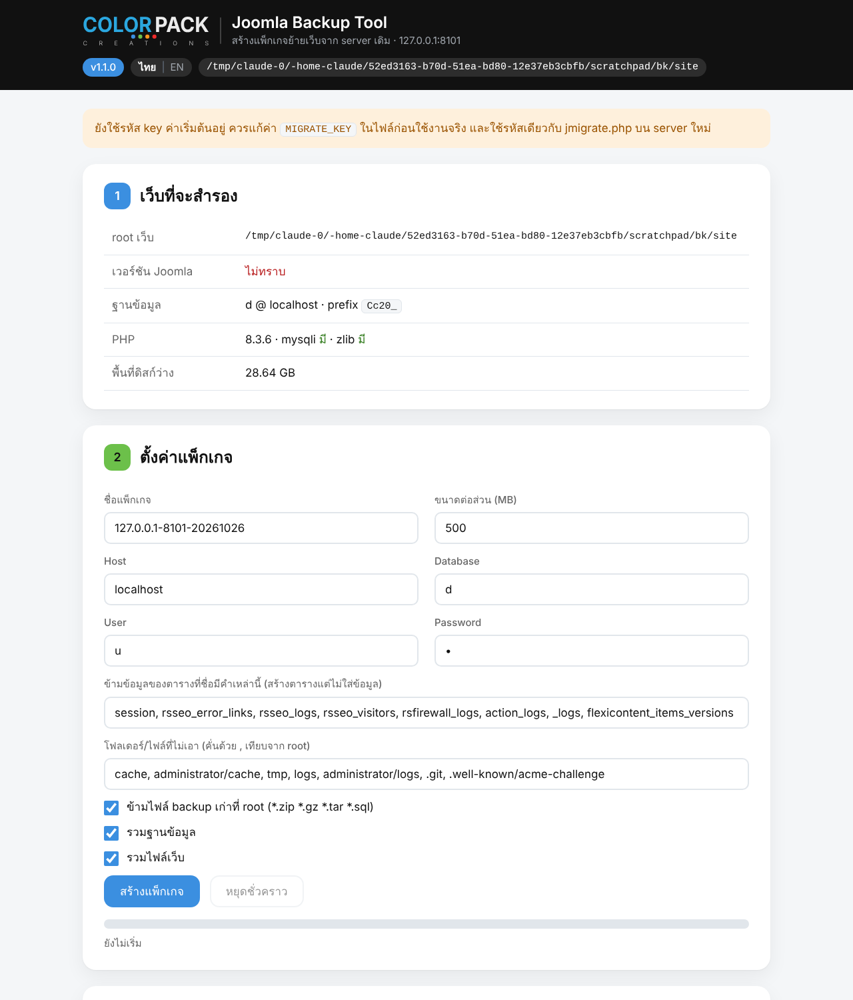

# Colorpack Joomla Migrate V1.2.1

**[EN]** Single-file PHP tool for moving a Joomla 3 / 4 / 5 site to a new server.
Fixes `configuration.php` paths, tests the database, imports huge `.sql` / `.sql.gz` dumps in
timeout-proof rounds with automatic error fixing, and ships the small utilities you always need
after a move (`.htaccess`, folders, cache, session table). No dependencies, no installation:
upload → open → migrate → delete.

**[TH]** เครื่องมือย้ายเว็บ Joomla 3 / 4 / 5 ไป server ใหม่แบบไฟล์เดียว
แก้ path ใน `configuration.php` ให้อัตโนมัติ ทดสอบฐานข้อมูล นำเข้าไฟล์ `.sql` / `.sql.gz` ขนาดใหญ่แบบแบ่งรอบไม่ติด timeout
พร้อมระบบแก้ error การนำเข้าอัตโนมัติ และเครื่องมือเสริมที่ต้องใช้หลังย้ายทุกครั้ง (`.htaccess`, โฟลเดอร์, cache, ตาราง session)
ไม่ต้องติดตั้ง — อัปโหลด → เปิด → ย้าย → ลบทิ้ง

**Files / ไฟล์:**
- [`jmigrate.php`](jmigrate.php) — on the **new** server: restore package, import DB, fix config / วางบน server **ใหม่**: กู้แพ็กเกจ นำเข้า DB แก้ config
- [`jbackup.php`](jbackup.php) — on the **old** server: build the migration package (files + DB) / วางบน server **เดิม**: สร้างแพ็กเกจย้ายเว็บ (ไฟล์ + DB)

(V1.2.1 · requires PHP 7.0+ with `mysqli` and `zlib` / ต้องใช้ PHP 7.0+ พร้อม `mysqli` และ `zlib`)

**Interface / หน้าจอ:** ไทย / English — switch in the top bar / สลับได้ที่แถบด้านบน

| jmigrate.php (TH) | jmigrate.php (EN) | jbackup.php |
|-----|---------|---------|
|  |  |  |

---

## วิธีใช้ / Quick start

1. Edit the access key at the top of the file (**required**):
   ```php
   const MIGRATE_KEY = 'changeme123';   // <<< change this
   ```
2. Upload `jmigrate.php` **and your database dump** (`.sql`, `.sql.gz` or a DirectAdmin `.gz` backup)
   into the site root — the same folder as `configuration.php`.
3. Open `https://yoursite.com/jmigrate.php` and enter the key on the login screen (`?key=…` in the URL still works).
4. The start card tells you what state the site is in and what to do next. Pick a flow — **A** migrate the whole site from a jbackup package, or **B** files already uploaded, import the database + fix config — and follow the numbered steps with **Next**.

> **Delete the tool from the server when you are done** (there is a button for it). It can rewrite
> `configuration.php` and your database.

### TH — ขั้นตอน

1. แก้ `MIGRATE_KEY` ในไฟล์เป็นรหัสของคุณเอง
2. อัปโหลด `jmigrate.php` และไฟล์ dump ฐานข้อมูล ไปไว้ที่ root ของเว็บ (ที่เดียวกับ `configuration.php`)
3. เปิด `https://โดเมน/jmigrate.php` แล้วกรอกรหัสในหน้า login (จะเปิดด้วย `?key=รหัส` ต่อท้าย URL ก็ยังได้)
4. การ์ดเริ่มต้นจะบอกว่าตอนนี้เว็บอยู่ในสถานะไหนและควรทำอะไรต่อ เลือกแบบ **A** ย้ายทั้งเว็บจากแพ็กเกจ jbackup หรือ **B** อัปโหลดไฟล์เองแล้ว นำเข้าฐานข้อมูล + แก้ config แล้วทำตามขั้นที่เรียงให้ด้วยปุ่ม **ถัดไป**

> ทำเสร็จแล้ว **ลบไฟล์ออกจาก server ทันที** (มีปุ่มให้) เพราะเครื่องมือนี้แก้ `configuration.php` และฐานข้อมูลได้

### Full-site migration (files + database) / ย้ายทั้งเว็บ (ไฟล์ + ฐานข้อมูล)

**[EN]** Use the same `MIGRATE_KEY` in both files.
1. **Old server:** upload `jbackup.php` to the site root, open `jbackup.php`, sign in with the key, press **Build package**. It dumps the database table by table and zips the site files in resumable rounds into `jbackup-<name>/` (db.sql.gz, site-partN.zip, manifest.json with checksums).
2. **New server:** upload `jmigrate.php` to the empty site root, open it, choose flow **A**. Step 1 *Restore from package*: either **Pull from the old server** (paste the `jbackup.php` URL, list, pick, pull — 8 MB HTTPS ranges, checksum-verified) or **Already on this server** if you uploaded the `jbackup-*` folder yourself (no download, just extract).
3. Step 2 *Import database* — `db.sql.gz` from the package is pre-selected, the prefix comes from the manifest.
4. Step 3 *Database & configuration.php* — enter the new DB credentials and save; paths are auto-detected.
5. Step 4 *Replace old domain / path* if the domain or server path changed — serialized- and JSON-safe (skip if unchanged).
6. Remaining steps: health check, config switches, tools (`.htaccess`, cache), then delete both tools and the package folders.

**[TH]** ใช้ `MIGRATE_KEY` เดียวกันทั้งสองไฟล์
1. **server เดิม:** อัปโหลด `jbackup.php` ไว้ที่ root ของเว็บ เปิด `jbackup.php` กรอกรหัส กด **สร้างแพ็กเกจ** ระบบจะ dump ฐานข้อมูลทีละตาราง และ zip ไฟล์เว็บแบบแบ่งรอบ ได้โฟลเดอร์ `jbackup-<ชื่อ>/` (db.sql.gz, site-partN.zip, manifest.json พร้อม checksum)
2. **server ใหม่:** อัปโหลด `jmigrate.php` ไว้ที่ root ว่าง ๆ เปิด → เลือกแบบ **A** ขั้นที่ 1 *กู้จากแพ็กเกจ*: เลือก **ดึงจาก server เดิม** (วาง URL ของ `jbackup.php` → ดูแพ็กเกจ → เลือก → ดึง ทีละ 8 MB ผ่าน HTTPS ตรวจ checksum) หรือ **อยู่บน server นี้แล้ว** ถ้าอัปโหลดโฟลเดอร์ `jbackup-*` มาเอง (ไม่ต้องดาวน์โหลด แค่แตกไฟล์)
3. ขั้นที่ 2 *นำเข้าฐานข้อมูล* — เลือก `db.sql.gz` จากแพ็กเกจให้แล้ว prefix เติมจาก manifest
4. ขั้นที่ 3 *ฐานข้อมูลและ configuration.php* — กรอก DB ใหม่แล้วบันทึก path ตรวจให้อัตโนมัติ
5. ขั้นที่ 4 *แทนที่โดเมน / path เดิม* ถ้าเปลี่ยนโดเมนหรือ path ปลอดภัยกับค่า serialized และ JSON (เหมือนเดิมก็ข้ามได้)
6. ขั้นที่เหลือ: ตรวจสุขภาพ config, คอนฟิกช่วงย้าย, เครื่องมือ (`.htaccess`, cache) แล้วลบเครื่องมือทั้งสองและโฟลเดอร์แพ็กเกจทิ้ง

---

## What it does / ทำอะไรได้บ้าง

**1. Environment check** — site root, PHP version and extensions (`mysqli`, `zlib`, GD/WebP), `open_basedir`,
whether the current `tmp_path` / `log_path` still point at the *old* server, and whether `.htaccess` exists.

**2. Database & configuration.php** — form for host / db / user / password with a connection test that reports
the MySQL version, `max_allowed_packet` and every table prefix found in the database (and warns when the prefix in
`configuration.php` does not match). `tmp_path` / `log_path` are pre-filled with the correct paths for the new server.
Every save backs up the previous file as `configuration.php.bak-<timestamp>`.

**2.1 configuration.php health check** — detects and (where safe) auto-fixes: UTF-8 BOM, whitespace before `<?php`,
trailing `?>` / junk after the class, duplicate keys, unbalanced braces, PHP syntax errors, missing or empty keys,
bad `dbprefix`, short `secret`, `live_site` pointing at another domain, file permissions.

**2.2 Migration config** — Debug, Error Reporting (default / none / simple / maximum / development), Site Offline
(+ message), SEF, URL Rewriting, System Cache, with one-click *troubleshoot* and *production* presets.

**3. Restore from package** — lists packages on the old server through its `jbackup.php`, pulls every part with HTTP Range requests (resumable, checksum-verified), extracts the zips with a built-in reader (no `ext/zip` needed; Thai file names and empty folders preserved), backs up the current `configuration.php` as `.bak-restore`, pre-fills prefix / DB file / old host and path from the manifest. Includes a serialized- and JSON-safe **search & replace** for the old domain and path across all text columns.

**4. Chunked import** — reads the dump statement by statement and works in rounds of ~8 seconds (`STEP_SECONDS`),
remembering its position in `jmigrate-state.json`, so a multi-GB dump never hits a 504 / `max_execution_time`.
Pause and **resume** at any time. `.gz` files are extracted in rounds too (with a guard against duplicate writes).
Options:
- **Skip data** for tables whose name contains given words (tables are created but left empty — ideal for
  `session`, `*_logs`, `rsseo_error_links`, `flexicontent_items_versions`, …)
- **Convert MyISAM / Aria → InnoDB** while importing (falls back per table when InnoDB refuses)
- **Fix import errors automatically** (see below)
- **Dry run** — read only; reports the largest tables so you can decide what to skip
- Progress bar, statements / skipped / converted / fixed / error counters, and a log of every fix applied

**5. Tools** — create `tmp` / `logs` / `cache` folders, create `.htaccess` from `htaccess.txt` (or a basic one),
truncate the session table, clear Joomla cache, convert existing MyISAM tables to InnoDB.

**6. Self-destruct** — removes `jmigrate.php`, the state file and the config backups.


### TH — ทำอะไรได้บ้าง

**1. ตรวจสภาพแวดล้อม** — root ของเว็บ, เวอร์ชัน PHP และ extension (`mysqli`, `zlib`, GD/WebP), `open_basedir`,
เช็คว่า `tmp_path` / `log_path` ปัจจุบันยังชี้ไป server *เก่า* หรือไม่ และมี `.htaccess` หรือไม่

**2. ฐานข้อมูลและ configuration.php** — ฟอร์มกรอก host / db / user / password พร้อมปุ่มทดสอบที่รายงานเวอร์ชัน MySQL,
`max_allowed_packet` และ prefix ตารางทุกชุดที่มีในฐานข้อมูล (เตือนเมื่อ prefix ใน `configuration.php` ไม่ตรง)
ช่อง `tmp_path` / `log_path` เติม path ที่ถูกต้องของ server ใหม่ให้ล่วงหน้า ทุกครั้งที่บันทึกจะสำรองไฟล์เดิมเป็น `configuration.php.bak-<เวลา>`

**2.1 ตรวจสุขภาพ configuration.php** — ตรวจและแก้อัตโนมัติ (เฉพาะที่ปลอดภัย): BOM, ช่องว่างก่อน `<?php`, `?>` ท้ายไฟล์และขยะหลัง class,
คีย์ซ้ำ, วงเล็บไม่สมดุล, PHP syntax error, คีย์หายหรือว่าง, `dbprefix` ผิดรูปแบบ, `secret` สั้น, `live_site` ชี้โดเมนอื่น, permission ของไฟล์

**2.2 คอนฟิกช่วงย้ายเว็บ** — Debug, Error Reporting (default / none / simple / maximum / development), Site Offline (+ ข้อความ),
SEF, URL Rewriting, System Cache พร้อมปุ่มลัด *โหมดหาสาเหตุ* และ *โหมดใช้งานจริง*

**3. กู้จากแพ็กเกจ** — ดูรายการแพ็กเกจบน server เดิมผ่าน `jbackup.php`, ดึงทุกส่วนด้วย HTTP Range (ทำต่อได้ ตรวจ checksum), แตก zip ด้วยตัวอ่านในตัว (ไม่ต้องมี `ext/zip` ชื่อไฟล์ไทยและโฟลเดอร์ว่างครบ), สำรอง `configuration.php` ปัจจุบันเป็น `.bak-restore`, เติม prefix / ไฟล์ DB / โดเมนและ path เดิมจาก manifest ให้ พร้อม **search & replace** โดเมนและ path เดิมในทุกคอลัมน์ข้อความ ปลอดภัยกับ serialized และ JSON

**4. นำเข้าแบบแบ่งรอบ** — อ่าน dump ทีละคำสั่ง ทำงานรอบละประมาณ 8 วินาที (`STEP_SECONDS`) และจำตำแหน่งไว้ใน `jmigrate-state.json`
ไฟล์หลาย GB จึงไม่ติด 504 / `max_execution_time` หยุดและ**ทำต่อ**ได้ทุกเมื่อ ไฟล์ `.gz` แตกเป็นรอบเช่นกัน (มีตัวกันเขียนซ้ำ)
ตัวเลือก:
- **ข้ามข้อมูล** ของตารางที่ชื่อมีคำที่กำหนด (สร้างตารางแต่ไม่ใส่ข้อมูล เหมาะกับ `session`, `*_logs`, `rsseo_error_links`, `flexicontent_items_versions`, …)
- **แปลง MyISAM / Aria → InnoDB** ระหว่างนำเข้า (ตารางไหนแปลงไม่ได้จะถอยกลับให้เอง)
- **แก้ error การนำเข้าอัตโนมัติ** (ดูตารางด้านล่าง)
- **Dry run** — อ่านอย่างเดียว แล้วสรุปตารางที่ใหญ่ที่สุดเพื่อตัดสินใจว่าจะข้ามอะไร
- แถบความคืบหน้า, ตัวนับคำสั่ง / ข้าม / แปลง / แก้ / error และ log ของทุกการแก้ที่ใช้

**5. เครื่องมือเสริม** — สร้างโฟลเดอร์ `tmp` / `logs` / `cache`, สร้าง `.htaccess` จาก `htaccess.txt` (หรือแบบพื้นฐาน),
ล้างตาราง session, ล้าง cache ของ Joomla, แปลงตาราง MyISAM ที่มีอยู่เป็น InnoDB

**6. ลบตัวเอง** — ลบ `jmigrate.php`, ไฟล์ state และไฟล์สำรอง config

### jbackup.php (old server) / ฝั่ง server เดิม

**[EN]** Dumps the database table by table (keyset-paged, 1,000 rows per INSERT, binary columns as hex, views without DEFINER, skip-data list) into `db.sql.gz`, scans the site tree and writes the files into standalone zip parts with its own streaming writer (append-only, so a 5 GB site never rewrites the archive; parts split at the chosen size; files over 64 MB are stored uncompressed for speed). Excludes `cache`, `tmp`, `logs`, `.git`, old backups and itself. Writes `manifest.json` (Joomla version, prefix, root, host, counts, MD5 of every part). Serves the parts with HTTP Range support and a package list for `jmigrate.php`; the package folder is protected by `.htaccess` and the key. Resumable, pause/resume, delete, self-destruct.

**[TH]** dump ฐานข้อมูลทีละตาราง (แบ่งหน้าแบบ keyset, 1,000 แถวต่อ INSERT, คอลัมน์ binary เป็น hex, view ไม่มี DEFINER, รายการข้ามข้อมูล) เป็น `db.sql.gz`, สำรวจไฟล์เว็บแล้วเขียนเป็น zip หลายส่วนด้วยตัวเขียนแบบสตรีมของตัวเอง (เขียนต่อท้ายอย่างเดียว เว็บ 5 GB ก็ไม่ต้องเขียนไฟล์ใหม่ทั้งก้อน; แบ่งส่วนตามขนาดที่เลือก; ไฟล์เกิน 64 MB เก็บแบบไม่บีบอัดเพื่อความเร็ว) ยกเว้น `cache`, `tmp`, `logs`, `.git`, backup เก่า และตัวมันเอง เขียน `manifest.json` (เวอร์ชัน Joomla, prefix, root, โดเมน, จำนวน, MD5 ทุกส่วน) ให้ `jmigrate.php` ดึงได้แบบ HTTP Range โฟลเดอร์แพ็กเกจกันด้วย `.htaccess` และ key ทำต่อได้ หยุด/ทำต่อ ลบ ลบตัวเอง

### Automatic import-error fixing / การแก้ error อัตโนมัติ

| Error | Fix | การแก้ |
|-------|-----|--------|
| MySQL 8 dump on MariaDB / MySQL 5.x (`utf8mb4_0900_*`) | collation rewritten to `utf8mb4_unicode_ci` / `utf8mb4_bin` (pre-emptively) | แทน collation เป็น `utf8mb4_unicode_ci` / `utf8mb4_bin` ล่วงหน้า |
| `DEFINER=` in views / triggers / procedures | removed | ลบออก |
| `SET @@GLOBAL.GTID_PURGED`, `SQL_LOG_BIN` | skipped | ข้าม |
| INSERT larger than `max_allowed_packet` | split into several INSERTs at row boundaries | แบ่งเป็นหลาย INSERT ตามขอบเขตแถว |
| 1273 / 1115 unknown collation or charset | replaced (`unicode_520_ci`, `utf8mb3`, …) | แทนด้วยตัวที่ server รู้จัก |
| 1286 unknown engine | `ENGINE=InnoDB` | เปลี่ยนเป็น InnoDB |
| 1118 row size too large | InnoDB + `ROW_FORMAT=DYNAMIC` → long `varchar` → `TEXT` → MyISAM | ลองตามลำดับจนผ่าน |
| 1071 key too long | `ROW_FORMAT=DYNAMIC` → `(191)` index prefix on long text columns | ใส่ prefix `(191)` ให้ index |
| 1062 duplicate entry | `INSERT IGNORE` | เปลี่ยนเป็น `INSERT IGNORE` |
| 1050 table exists | `CREATE TABLE IF NOT EXISTS` | สร้างเฉพาะเมื่อยังไม่มี |
| 1064 syntax (`DEFINER`, `ALGORITHM`, `VISIBLE`) | offending clause removed | ลบส่วนที่ server ไม่รู้จัก |
| 1227 / 1044 / 1419 privilege errors | privileged `SET` skipped, `DEFINER` removed | ข้าม `SET` พิเศษ / ลบ `DEFINER` |
| 1067 / 1292 invalid default | strict mode off → `0000-00-00` default → `NULL` | ปิด strict mode → เปลี่ยน default เป็น `NULL` |
| 1214 no FULLTEXT support | that table falls back to MyISAM | ตารางนั้นถอยกลับเป็น MyISAM |
| 2006 / 2013 server has gone away | reconnects and splits the INSERT, then continues | เชื่อมต่อใหม่ แบ่ง INSERT แล้วทำต่อ |

### Options (top of the file) / ตัวเลือก (ด้านบนของไฟล์)

| Option | Meaning | ความหมาย |
|--------|---------|----------|
| `MIGRATE_KEY` | Access key for the login screen (required; also accepted as `?key=`) | รหัสเข้าใช้สำหรับหน้า login (จำเป็น; ใส่เป็น `?key=` ก็ได้) |
| `STEP_SECONDS` | Seconds of work per round (default 8; lower it if your server times out early) | เวลาทำงานต่อรอบ (ค่าเริ่มต้น 8 ถ้า server timeout ไวให้ลดลง) |
| `GZ_CHUNK` | Upper bound of bytes extracted from a `.gz` per round | เพดานจำนวน byte ที่แตกจาก `.gz` ต่อรอบ |
| `BMC_URL` | Buy-me-a-coffee link shown in the footer | ลิงก์ Buy me a coffee ที่แสดงใน footer |
| `PART_SIZE` / `STORE_OVER` (jbackup) | Zip part size; files larger than this are stored uncompressed | ขนาดต่อส่วนของ zip; ไฟล์ใหญ่กว่านี้เก็บแบบไม่บีบอัด |

---

## Notes / ข้อควรรู้

**[EN]**
- Very large `.gz` files: extraction through the page re-reads from the start each round, so for files over a few
  hundred MB it is faster to extract first (DirectAdmin File Manager → Extract, or `gunzip -k file.gz`) and import the `.sql`.
- Dumps that use `DELIMITER` (stored procedures / triggers) are not supported — Joomla dumps normally have none.
- Statements that fail because an earlier `CREATE TABLE` failed show up as repeated `1146` errors; look at the first
  error for that table.
- Never leave `jmigrate.php` or your `.sql` dump in `public_html` after migrating.

**[TH]**
- ไฟล์ `.gz` ใหญ่มาก: การแตกผ่านหน้าเว็บต้องอ่านซ้ำจากต้นไฟล์ทุกรอบ ถ้าไฟล์เกินไม่กี่ร้อย MB ให้แตกก่อน
  (File Manager ของ DirectAdmin → Extract หรือ `gunzip -k ไฟล์.gz`) แล้วนำเข้าไฟล์ `.sql` จะเร็วกว่า
- ไม่รองรับ dump ที่ใช้ `DELIMITER` (stored procedure / trigger) ซึ่ง dump ของ Joomla ปกติไม่มี
- คำสั่งที่พังเพราะ `CREATE TABLE` ก่อนหน้าพังไปแล้ว จะขึ้นเป็น error `1146` ซ้ำ ๆ ให้ดู error แรกของตารางนั้น
- ห้ามทิ้ง `jmigrate.php` หรือไฟล์ `.sql` ไว้ใน `public_html` หลังย้ายเสร็จ

---

## Changelog / บันทึกการแก้ไข

### 1.2.1 — 2026-10-27
**[EN]** Fix-in-place buttons on the environment check: a wrong `tmp_path` / `log_path` shows the correct path with a **Fix it now** button (creates the folders and rewrites configuration.php with a backup); a missing `.htaccess` gets **Create .htaccess now**.

**[TH]** ปุ่มแก้ทันทีในหน้าตรวจสภาพแวดล้อม: `tmp_path` / `log_path` ที่ผิดจะแสดง path ที่ควรเป็นพร้อมปุ่ม **แก้ให้เลย** (สร้างโฟลเดอร์และเขียน configuration.php ให้ สำรองไฟล์เดิมก่อน) และ `.htaccess` ที่หายมีปุ่ม **สร้าง .htaccess ให้เลย**

### 1.2.0 — 2026-10-27
**[EN]** Guided UI.
- Start card detects the situation (empty folder / files but no configuration.php / DB unreachable / DB empty / config mismatch / ready) and says what to do next, with a status checklist that jumps to the right step
- Two flows: **A** migrate from a jbackup package (restore → import → config → replace → …) and **B** files already uploaded (environment → config → import → …); steps are renumbered per flow, one step open at a time, **Next / Back** buttons, progress stepper, remembered per browser
- Restore step asks where the package is: **already on this server** (uploaded `jbackup-*` folder — no download, just extract) or **pull from the old server**
- Domain / path replace is now its own step

**[TH]** หน้าจอแบบนำทาง
- การ์ดเริ่มต้นตรวจสถานการณ์ให้ (โฟลเดอร์ว่าง / มีไฟล์แต่ไม่มี configuration.php / ต่อ DB ไม่ได้ / DB ว่าง / config ไม่ตรง / พร้อมแล้ว) และบอกว่าควรทำอะไรต่อ พร้อมรายการเช็คสถานะที่กดกระโดดไปขั้นที่เกี่ยวได้
- เลือกได้ 2 แบบ: **A** ย้ายจากแพ็กเกจ jbackup (กู้ → นำเข้า → config → แทนที่ → …) และ **B** อัปโหลดไฟล์เองแล้ว (สภาพแวดล้อม → config → นำเข้า → …) เลขขั้นเรียงใหม่ตามแบบที่เลือก เปิดทีละขั้น มีปุ่ม **ถัดไป / ย้อนกลับ** แถบความคืบหน้า และจำขั้นที่ค้างไว้
- ขั้นกู้จากแพ็กเกจถามก่อนว่าแพ็กเกจอยู่ที่ไหน: **อยู่บน server นี้แล้ว** (อัปโหลดโฟลเดอร์ `jbackup-*` มาเอง ไม่ต้องดาวน์โหลด แค่แตกไฟล์) หรือ **ดึงจาก server เดิม**
- แทนที่โดเมน / path แยกเป็นขั้นของตัวเอง

### 1.1.1 — 2026-10-26
**[EN]** Login screen: the access key is entered in a password field instead of the URL (a signed cookie keeps you signed in for 24 h; `?key=` still works for scripts and for server-to-server pulls). Sign-out link in the header. Wrong key waits 1 s.

**[TH]** หน้า login: กรอกรหัสในช่องรหัสผ่านแทนการใส่ใน URL (cookie แบบเซ็นลายเซ็นจำไว้ 24 ชม.; `?key=` ยังใช้ได้สำหรับสคริปต์และการดึงข้ามเครื่อง) มีปุ่มออกจากระบบที่แถบบน รหัสผิดหน่วง 1 วินาที

### 1.1.0 — 2026-10-26
**[EN]** Full-site migration.
- New `jbackup.php` for the old server: resumable database dump + streaming multi-part zip of the site files, manifest with checksums, Range-enabled download endpoint, package list
- `jmigrate.php` section 3 **Restore from package**: list packages on the old server, pull over HTTPS in resumable 8 MB ranges with checksum verification (or use an uploaded `jbackup-*` folder), extract with a built-in zip reader, pre-fill prefix / DB file / old host and path from the manifest
- Serialized- and JSON-safe **search & replace** of the old domain and path in the database, with a dry-run count
- DB import now also lists `jbackup-*/db.sql.gz`; sections renumbered (import 4, tools 5, finish 6)

**[TH]** ย้ายทั้งเว็บ
- เพิ่ม `jbackup.php` สำหรับ server เดิม: dump ฐานข้อมูลแบบทำต่อได้ + zip ไฟล์เว็บหลายส่วนแบบสตรีม, manifest พร้อม checksum, endpoint ดาวน์โหลดรองรับ Range, รายการแพ็กเกจ
- `jmigrate.php` ข้อ 3 **กู้จากแพ็กเกจ**: ดูแพ็กเกจบน server เดิม, ดึงผ่าน HTTPS ทีละ 8 MB ทำต่อได้ ตรวจ checksum (หรือใช้โฟลเดอร์ `jbackup-*` ที่อัปโหลดมา), แตกไฟล์ด้วยตัวอ่าน zip ในตัว, เติม prefix / ไฟล์ DB / โดเมนและ path เดิมจาก manifest
- **search & replace** โดเมนและ path เดิมในฐานข้อมูล ปลอดภัยกับ serialized และ JSON มีโหมดทดสอบนับแถว
- นำเข้า DB เห็นไฟล์ `jbackup-*/db.sql.gz` ด้วย; เลขข้อเปลี่ยน (นำเข้า 4, เครื่องมือ 5, เสร็จ 6)

### 1.0.0 — 2026-10-25
**[EN]** First public release.
- configuration.php path auto-detection, health check with safe auto-fix, migration config switches
- Database form with connection test and table-prefix detection
- Chunked, resumable import of `.sql` / `.sql.gz` / DirectAdmin `.gz` with per-round extraction guard
- Automatic import-error fixing (MySQL 8 collations, DEFINER, key length, row size, duplicates, packet size, reconnect)
- MyISAM / Aria → InnoDB conversion during import and for existing tables
- Skip-data list, dry run with largest-table report
- Tools: folders, `.htaccess`, session truncate, cache clear, self-destruct
- Thai / English interface, Colorpack footer

**[TH]** เวอร์ชันแรกที่เผยแพร่
- ตรวจ path ของ configuration.php อัตโนมัติ, ตรวจสุขภาพไฟล์พร้อมแก้อัตโนมัติ, คอนฟิกช่วงย้ายเว็บ
- ฟอร์มฐานข้อมูลพร้อมทดสอบการเชื่อมต่อและหา prefix ตาราง
- นำเข้า `.sql` / `.sql.gz` / `.gz` จาก DirectAdmin แบบแบ่งรอบ ทำต่อได้ มีตัวกันเขียนซ้ำตอนแตกไฟล์
- แก้ error การนำเข้าอัตโนมัติ (collation MySQL 8, DEFINER, key ยาวเกิน, row size, duplicate, packet, เชื่อมต่อใหม่)
- แปลง MyISAM / Aria → InnoDB ทั้งระหว่างนำเข้าและตารางที่มีอยู่
- รายการข้ามข้อมูล, dry run พร้อมสรุปตารางที่ใหญ่ที่สุด
- เครื่องมือเสริม: โฟลเดอร์, `.htaccess`, ล้าง session, ล้าง cache, ลบตัวเอง
- หน้าจอไทย / อังกฤษ, footer ของ Colorpack

---

## Credits / เครดิต

© 2026 บริษัท คัลเลอร์แพค ครีเอชั่น จำกัด (Colorpack Creation Co., Ltd.) · [colorpack.co.th](https://colorpack.co.th/)

If this tool saved you a late night, you can buy me a coffee / ถ้าเครื่องมือนี้ช่วยให้คุณไม่ต้องอดนอน เลี้ยงกาแฟได้ที่นี่

👉&nbsp;&nbsp;&nbsp;&nbsp;&nbsp;&nbsp;<a href="https://buymeacoffee.com/cheuachatchai" ></a>
